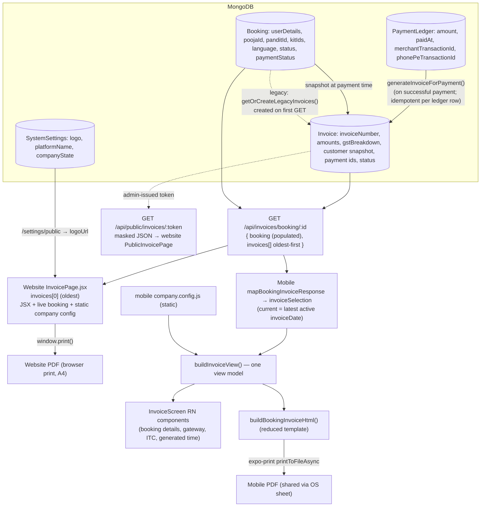

# Invoice Source-of-Truth and Website/Mobile Parity Audit

**Date:** 2026-10-28 · **Branch:** `main` (HEAD `3311136`) · **Type:** read-only code audit. No implementation file, test, API contract, model, dependency, config or persisted record was changed. This report is the only file created.

**Evidence used:** the two owner-supplied PDFs (`mobile-invoice.pdf`, `Zutsav — Spiritual Platform(website).pdf`, text and rendered pages), and the source files cited below. Nothing was executed against a running backend, device or database. Anything that needs runtime evidence is marked as such.

**Privacy:** customer name, phone, email and address in the sample are deliberately not repeated. The invoice number, order number and merchant transaction ID appear because the task names them as the comparison keys.

Confidence labels used throughout (per the task):
**[C]** Confirmed by source-code/API evidence · **[L]** Likely but not fully verified · **[U]** Unknown; requires additional evidence.

---

## A. Executive summary

1. **The two PDFs are the same invoice record rendered by two different renderers. It is a presentation/template mismatch, not a data/record mismatch.** Invoice number, order number, dates, the three line items, subtotal, IGST, grand total, payment status and merchant transaction ID are identical in both PDFs. **[C]** that both clients call the same endpoint; **[C]** that the sample's identifiers and amounts agree.
2. **There is no shared renderer and no stored official document.** The website "PDF" is a React page (`InvoicePage.jsx`) that the browser prints (`window.print()`). The mobile "PDF" is an HTML string (`bookingInvoiceHtml.js`) turned into a file by `expo-print`. The backend has no PDF/HTML generator, no stored document and no document URL; it serves only the persisted `Invoice` JSON. **[C]**
3. **The mobile PDF is a deliberately smaller layout.** The text of the supplied mobile PDF matches the strings in `bookingInvoiceHtml.js` one-for-one, including the ones that differ from the website ("Samagri Kit — GST", "Platform Convenience Fee — GST", "This is a computer-generated invoice"). **[C]**
4. **Most "missing" website fields are template omissions, not data gaps.** The mobile view model (`buildInvoiceView`) already holds the gateway name, gateway transaction ID, language, urgency, location, Pandit and kit. The PDF template just does not print them. The on-screen mobile invoice (`InvoiceScreen`) does print most of them, so the app has a **third** renderer that is closer to the website than its own PDF. **[C]**
5. **A few website fields have no persisted source at all:** "Payment Method: UPI / PhonePe" (literal), "GSTIN: Unregistered" (literal), "Generated:" (render time), the logo (admin settings, not the invoice) and "Service At" (a second print of the Bill To data). **[C]**
6. **No evidence of a stale invoice for the supplied sample.** Both PDFs show the same invoice number, and the sample is a single full payment. A structural stale-invoice risk exists for multi-payment bookings, and it is on the **website** side (it opens `invoices[0]`, the oldest). **[C]** for the code; **[U]** for any real affected booking.
7. **Recommended path:** there is no existing canonical artifact to reuse (Option A is not available today). The lowest-risk route to match the website is **Option C-first: bring the mobile HTML template to field parity with the website using data already in the response**. A server-rendered canonical document (Option B) is the durable fix but needs new backend work and an owner decision. See section I.

---

## B. Supplied PDF comparison

### B.1 Fields observed identical in both PDFs (sample only)

| Field | Value in both PDFs |
|---|---|
| Invoice number | `INV-2026-000037` |
| Order / booking ID | `ZUT668341032` |
| Issue date | 28 Oct 2026 |
| Service date | Saturday, 31 October 2026 |
| Service / time / Pandit | Ganesh Laxmi Puja / 08:00 / "Pandit" |
| Line items | ₹2,000 (pooja), ₹275 (kit "basic kit"), ₹100 (platform fee) |
| Subtotal / IGST / Grand total | ₹2,375 / ₹67.5 (18%) / ₹2,442.5 |
| Payment type / status | Full Payment / Paid in Full |
| Merchant transaction ID | `ZUT_1793166668333_f8fdd0` |
| Seller identity block | same name, address, GSTIN, PAN, support email/phone/site |
| Amount in words | "Two Thousand Four Hundred Forty Two Rupees and Fifty Paise Only" |

These are evidence from this one invoice only. Parity for other invoices (multi-kit, multi-payment, CGST/SGST, urgent, cancelled) is **not** shown by these PDFs. Note the amounts print as `₹2,442.5` (not `₹2,442.50`) in both: both formatters use up to 2 decimals without padding.

### B.2 Sections present in the website PDF and absent or different in the mobile PDF

Header logo image and "PVT. LTD." line; header status pill "Paid in Full"; separate **Bill To / Service At** blocks (address on separate lines, "GSTIN: Unregistered"); a **Booking Details** panel (Service, Date, Time, Language, Booking Type, Location, Pandit, Samagri Kit, Booking ID); the **Payment Details** cards plus a gateway box (Payment Type, **Payment Gateway**, Merchant Txn ID, **Gateway Txn ID**, **Payment Method**); tax-summary wording ("Platform Convenience Fee Tax", "basic kit — GST"); footer tagline "May your prayers be answered with divine grace.", Support/WhatsApp/Website grid, the **ITC statement** and a **Generated:** timestamp.

The mobile PDF instead has: a text-only header ("ZUTSAV PVT. LTD."), a short Booking Details list (Service, Time, Pandit), one comma-joined Bill To line, a plain Payment table, generic tax-row labels, and a one-line footer.

Page geometry also differs (observed from the supplied renders, approximate): website page ratio ≈ 0.71 (A4 portrait, matches `@page { size: A4 portrait; margin: 6mm }`), mobile page ratio ≈ 0.77 (consistent with a US-Letter default; `Print.printToFileAsync({ html })` passes no page size). Not verified at runtime.

---

## C. Website invoice source trace

| Step | Source | Notes |
|---|---|---|
| Entry (My Bookings) | `frontend/src/pages/MyBookings.jsx:386-391` → link `/invoice/${b._id}` | |
| Routes | `frontend/src/App.jsx:146-150` — `/invoice/view/:invoiceNumber`, `/invoice/:bookingId` (both `ProtectedRoute`); `:145` `/share/invoice/:token` (public) | |
| Fetch | `frontend/src/pages/InvoicePage.jsx:288-298` — `GET /invoices/number/:no` or `GET /invoices/booking/:bookingId` | Same API as mobile **[C]** |
| Invoice selection | `InvoicePage.jsx:316-318` — `invoice = data.invoice \|\| data.invoices[0]` | `invoices[0]` is the **oldest** (API sorts `invoiceDate: 1`, `invoice.controller.js:47-48`) |
| Pricing | `InvoicePage.jsx:26-56` `resolvePricing(invoice \|\| b)` — persisted invoice amounts; `totalTax = kitGST + platformGST` (`:41`) | |
| Line items | `:199-266` `buildLineItems(b, pricing)` — descriptions from the booking; pooja/fee/surcharge amounts from the invoice; **per-kit unit price = live `kit.discountPrice`** (`:226-232`) | |
| Seller block | `:453-460` from `frontend/src/config/company.config.js` (static) | no seller snapshot on booking invoices |
| Logo | `:435-451` `useSettings().logoUrl` (admin settings via `SettingsContext`) | not part of the invoice payload |
| Bill To / Service At | `:503-526` — both blocks print `b.userDetails` (live booking) | the two blocks are the same data |
| Booking details | `:529-553` | `Language: b.language \|\| 'Hindi'` (`:537`) |
| Payment gateway box | `:663-684` — `invoice.paymentGateway`, `merchantTransactionId`, `gatewayTransactionId`; **"Payment Method" is the literal `'UPI / PhonePe'`** (`:675`) | |
| Tax summary | `:729-832` — rate **hard-coded "18%"** (`:775`, `:791`), label `IGST (18%)` hard-coded (`:602`); CGST/SGST vs IGST from persisted `gstBreakdown.isInterstate` (`:381`) | |
| Footer | `:859-889` — ITC statement `:883`; `Generated:` = `new Date()` at render (`:389`, `:886`) | not persisted |
| Output | `:410` `window.print()`; print CSS `:107-118` | browser print-to-PDF; no server artifact |
| Public share | `PublicInvoicePage.jsx` → `InvoicePage publicData=…`; `GET /api/public/invoices/:token` (`backend/src/routes/publicInvoice.routes.js`, `invoiceShare.controller.js:133-146`, `invoiceShareService.js:187-223`) | admin-issued bearer link; masks phone/email; omits gateway ids; JSON only **[C]** |

**Backend contract** (`backend/src/routes/invoice.routes.js`, mounted `app.js:182`, all behind `protect`):

- `GET /api/invoices/booking/:bookingId` → `{ success, booking, invoices[] }` (`invoice.controller.js:34-57`). Owner or admin only (`:43`). Invoices sorted `invoiceDate` ascending. If none exist, `getOrCreateLegacyInvoices(booking)` **creates** them on demand (`:51-53`) — a GET that writes.
- `GET /api/invoices/number/:invoiceNumber` → `{ invoice, booking }` (`:63-98`).
- `GET /api/invoices/my` (`:102-117`) — list; no client calls it (also noted in `docs/MOBILE_FEATURE_GAP_ANALYSIS.md:283`).

**Persisted model** — `backend/src/models/Invoice.js:48-160`: identity (`invoiceNumber` unique), `source` (`booking`/`manual`), `bookingId`, `paymentLedgerId`, `customerId`, booking snapshot (`bookingNumber`, `poojaName`, `scheduledDate/Time`), customer snapshot (`customerName/Phone/Email/Address/Pincode/State/City`), `invoiceDate`, payment (`paymentType`, `paymentGateway`, `merchantTransactionId`, `gatewayTransactionId`, `amountPaid`, `previouslyPaid`, `outstandingAfter`), totals (`grandTotal`, `poojaAmount`, `kitAmount`, `kitGST`, `platformFee`, `platformGST`, `urgentSurcharge`, `totalGST`), `gstBreakdown`, `status` (`active|cancelled|archived`), `isLegacy`, `invoiceVersion` (default 1, never otherwise set), `timestamps`. **No** line items, subtotal, seller snapshot, document URL, PDF/HTML blob or generated-document timestamp for booking invoices (line items and `sellerSnapshot` exist only for `source: 'manual'`). **[C]**

**Creation** — `backend/src/utils/invoiceGenerator.js:86-150` `generateInvoiceForPayment` (called from `booking.controller.js:519, 713, 763, 799`): one invoice **per PaymentLedger entry**, idempotent on `paymentLedgerId`, copying amounts and customer snapshot from the booking at payment time; `gstBreakdown` from `buildGstBreakdown` (`:64-70`) comparing `booking.userDetails.state` with the configured company state (`:12-16`). The legacy path `getOrCreateLegacyInvoices` (`:159-271`) does the same retroactively (`generatedBy: 'migration'`, `isLegacy: true`).

**Answer — is the website output derived from persisted snapshots or reconstructed?** A mix. Amounts, invoice number/date, payment identifiers and the GST split come from the persisted invoice. Customer details, Place of Supply, Pandit, kit names, language, payment **status**, seller identity, tax **rate** text, payment method and generated time are taken from the **live booking, static config or literals** at view time. **[C]**

---

## D. Mobile invoice source trace

**Flow:** `BookingDetailScreen.jsx:337` → `navigation.navigate('Invoice', { type: 'booking', id: bookingId })` → `InvoiceScreen.jsx:59-88` → `api.get('/invoices/booking/${id}')` (`:76`) → `mapBookingInvoiceResponse` (`bookingInvoice.js:30-35`) → `resolveSelectedIndex` (`invoiceSelection.js:39-43`) → `buildInvoiceView` (`bookingInvoice.js:189-245`) → two renderers: on-screen components (`InvoiceScreen.jsx:559-573`) and `buildBookingInvoiceHtml(view)` (`bookingInvoiceHtml.js:15-84`) → `Print.printToFileAsync({ html })` → `Sharing.shareAsync(uri)` (`InvoiceScreen.jsx:103-118`).

Other entry points that open the same screen: `AdminBookingDetailScreen.jsx:129`, `AdminRefundDetailScreen.jsx:121`, `OrderDetailScreen.jsx:287` (`type: 'order'`, marketplace — a different invoice, out of scope here). `PanditNavigator.jsx:73` registers the screen but no Pandit screen navigates to it.

| Question in the brief | Finding |
|---|---|
| Which endpoint is called? | `GET /api/invoices/booking/:id` (`InvoiceScreen.jsx:76`). The legacy `/bookings/:id/invoice` is no longer used by mobile (`docs/MOBILE_TESTING.md:117-119`). **[C]** |
| Is the persisted invoice the source of the PDF? | Yes for identity, amounts, tax, payment ids. **[C]** |
| Does `InvoiceScreen` create a document? | It does not create an invoice. It renders the fetched ones and builds a **new PDF file locally on each Share** from the in-memory `view` (`:106-107`). No document is fetched or cached. **[C]** |
| Is `bookingInvoiceHtml.js` used in the real flow? | Yes, `InvoiceScreen.jsx:16, :106`. The sample mobile PDF text equals its template strings. **[C]** |
| Created from booking fields, invoice fields, or a document URL? | Invoice fields for amounts/identity/customer snapshot; booking fields for descriptions, Pandit, kit, language, status. No document URL exists to use. **[C]** |
| Are item/tax calculations reconstructed on mobile? | Line **amounts** are persisted; line **descriptions** and the Subtotal (sum of displayed lines) are built locally (`bookingInvoice.js:79-132`, `:231`). Tax **rates** are derived from stored amounts (`:135, :147-152`), not hard-coded. Kit per-line prices use live catalog price only when they sum exactly to the persisted `kitAmount` (`:101-109`). **[C]** |
| Do screen and share use the same record? | Yes: one `view` feeds both (`InvoiceScreen.jsx:98-101, :106`), asserted by `InvoiceScreen.currentInvoice.test.jsx:225,238`. But they use **different renderers**, so the on-screen invoice and the PDF show different fields. **[C]** |
| Can stale state / selection / cache / races produce an older invoice? | Pre-fix: yes, by design (`selected = 0` = oldest). The working-tree (uncommitted) change adds current-invoice selection (`invoiceSelection.js:17-43`), id-keyed selection, a request ticket (`InvoiceScreen.jsx:57-77`) and clears prior data on reload. No cache layer exists in this flow (`api/axios.js` has none for this call). **[C]** for the code as it sits in the working tree; **[U]** whether the APK the owner tested contains it. |
| What is the app showing? | The same persisted record as the website, rendered by a separate, smaller template. **[C]** |

**Mobile-only observations**

- Share only: there is no in-app PDF preview and no save/download action; the OS share sheet receives a freshly generated file (`InvoiceScreen.jsx:107-110`).
- Seller identity comes from `mobile-app/src/config/company.config.js` (static, a second copy of the website's), unless a `sellerSnapshot` exists (never for booking invoices) (`bookingInvoice.js:167-186`). The logo is not used on mobile (`/settings/public` is not consulted by the invoice code).
- The Day 21 guards pin the current behaviour: the HTML must be byte-identical across UI languages and `bookingInvoice*` must not import the localization layer (`PaymentInvoice.localization.test.jsx:342-349`; `docs/MOBILE_TESTING.md:574-577`). Tests assert that the HTML **contains** required values (`bookingInvoice.test.js:203-230`), not that it lacks others, so adding fields will not break them, but changing wording around existing strings may.

---

## E. Data lineage diagram

There is no arrow from the database to any stored PDF/HTML: none exists.

---

## F. Field-level parity matrix

Classification key: **R** = rendering/template difference · **M** = mapping/data-availability · **G** = generation-path difference · **?** = unresolved question. Contact details are not reproduced.

| # | Field / section | Website PDF | Mobile PDF | Result | Actual source (verified) | Class |
|---|---|---|---|---|---|---|
| 1 | Brand header | Logo image + "PVT. LTD." | Text "ZUTSAV PVT. LTD." | Difference | Web: `useSettings().logoUrl` (`InvoicePage:435`). Mobile: literal in `resolveSeller` (`bookingInvoice.js:181`). | R (logo not fetched on mobile = M) |
| 2 | Seller address / GSTIN / PAN / contacts | Same text | Same text | Match | Web `frontend/.../company.config.js`; mobile `mobile-app/.../company.config.js` (two static copies; web addr1 has a leading space) | ? (duplication; see section K) |
| 3 | "Tax Invoice" + "Full Payment" | Present | Present | Match | `PMT_LABEL[invoice.paymentType]` both | — |
| 4 | Invoice No | `INV-2026-000037` | same | Match | `Invoice.invoiceNumber` | — |
| 5 | Order No | `ZUT668341032` | same | Match | Web: `booking.bookingNumber`; mobile: `invoice.bookingNumber` then booking | — |
| 6 | Issue date | 28 Oct 2026 | same | Match | `Invoice.invoiceDate` (web falls back to `booking.createdAt`; mobile to "—") | — |
| 7 | Service date | Sat, 31 Oct 2026 | same | Match | Web: `booking.scheduledDate`; mobile: `invoice.scheduledDate` then booking | — |
| 8 | Place of supply | INDIA | INDIA | Match | Web: live `userDetails.state/city`; mobile: invoice snapshot state/city. Both fell back to "India" (no state/city on the sample) | ? (see K) |
| 9 | Header status pill | "Paid in Full" | absent (status only in Payment table) | Difference | Both derive status from the **live booking** (`resolvePaymentStatus`), not from the invoice | R |
| 10 | Bill To content | Present, address on separate lines | Present, address comma-joined | Match (content) / differs (layout) | Web: `booking.userDetails`; mobile: invoice customer snapshot, falling back to booking | R |
| 11 | "GSTIN: Unregistered" (customer) | Present | absent in PDF (present on mobile screen) | Difference | Literal text in both clients (`InvoicePage:523`, `InvoiceScreen:288`); no customer GSTIN field in `Invoice` | R / ? |
| 12 | Service At | Present | absent (also absent on mobile screen) | Difference | Web re-prints the **same** `userDetails` as Bill To (`InvoicePage:504-525`); no separate service-address field exists in the invoice payload | R / ? |
| 13 | Booking Details: Service, Time, Pandit | Present | Present | Match | Invoice `poojaName`/`scheduledTime`; `booking.panditId.name` | — |
| 14 | Booking Details: Date | Present in panel | only as header "Service Date" | Difference (placement) | same field as #7 | R |
| 15 | Booking Details: Language | Hindi (panel) | only inside line-item subtitle | Difference | `booking.language`; web defaults to "Hindi" when blank (`:537`), mobile leaves blank | R / G |
| 16 | Booking Details: Booking Type | Normal | absent | Difference | `booking.bookingType/isUrgent`; already in mobile `view.details.urgent` | R (omitted by template, `bookingInvoiceHtml.js:41`) |
| 17 | Booking Details: Location | Present | absent | Difference | `userDetails.address/city`; already in `view.details.location` | R |
| 18 | Booking Details: Samagri Kit | "basic kit" | kit appears only as a line item | Difference | `booking.kitIds/kitId`; already in `view.details.kit` | R |
| 19 | Booking Details: Booking ID | Present | = "Order No" | Difference (duplicate field) | `bookingNumber` | R |
| 20 | Line items (3 rows) | ₹2,000 / ₹275 / ₹100 | same | Match | Amounts: `Invoice.poojaAmount/kitAmount/platformFee`; descriptions from booking. Column header "Unit Price" vs "Rate" | R (header word) |
| 21 | Multi-kit lines | per-kit live `discountPrice` | per-kit only if sum = persisted, else combined line | Differs by design (not in sample) | `InvoicePage:226-232` vs `bookingInvoice.js:101-109` | G |
| 22 | Subtotal / tax line / grand total | ₹2,375 / IGST (18%) ₹67.5 / ₹2,442.5 | same | Match | Subtotal = sum of displayed lines (no persisted subtotal) on both; grand total = `Invoice.grandTotal`; web tax label hard-coded, mobile derived | — |
| 23 | Payment cards | Order Total, This Invoice | table rows, same values | Match (values) | `Invoice.grandTotal`, `amountPaid`, `previouslyPaid`, `outstandingAfter` | R |
| 24 | Payment Type | Shown | Header label only | Difference | `Invoice.paymentType` | R |
| 25 | Payment Gateway | "PHONEPE" | absent | Difference | `Invoice.paymentGateway` (always `'phonepe'` at creation, `invoiceGenerator.js:121`); already in `view.payment.gateway` | R |
| 26 | Merchant Txn ID | present | present | Match | `Invoice.merchantTransactionId` ← `ledger.merchantTransactionId` | — |
| 27 | Gateway Txn ID | present | absent | Difference | `Invoice.gatewayTransactionId` ← `ledger.phonePeTransactionId`; already in `view.payment.gatewayTransactionId` | R |
| 28 | Payment Method | "UPI / PhonePe" | absent | Difference | **Literal** in website code (`InvoicePage:675`); not stored anywhere. Prints "UPI" for any invoice with a gateway box | ? |
| 29 | Tax Summary row labels | "Platform Convenience Fee Tax", "basic kit — GST" | "Platform Convenience Fee — GST", "Samagri Kit — GST" | Difference (wording) | Web: kit names from booking; mobile: fixed text (`bookingInvoiceHtml.js:24`) | R |
| 30 | Tax rate in summary | "18%" | "18%" | Match (sample) | Web: **hard-coded 18%** (`:775,791`); mobile: `round2(tax/taxable*100)` (`bookingInvoice.js:135`) | G |
| 31 | Tax Summary column heads | "Item Description / Taxable Amount" | "Item / Taxable" | Difference | wording only | R |
| 32 | Total Tax Collected | ₹67.5 | ₹67.5 | Match | Web: `invoice.totalGST ?? kitGST+platformGST`; mobile: `invoice.totalGST ?? sum` | — |
| 33 | Amount in words | same sentence | same | Match | `amountPaid`; two independent word converters (`frontend/utils/numberToWords`, `mobile helpers.amtWords`) | ? (only this value compared) |
| 34 | Payment status (bottom) | Paid in Full | Paid in Full | Match | live booking (see #9) | — |
| 35 | Footer tagline + Support/WhatsApp/Website grid | present | one contact line | Difference | static config | R |
| 36 | ITC statement | present | absent in PDF (present on mobile screen) | Difference | literal text (`InvoicePage:883`, `InvoiceScreen:551`) | R / ? |
| 37 | "Generated:" timestamp | 28 Oct 2026, 6:37 pm | absent in PDF (screen shows its own render time) | Difference | `new Date()` at render on both; not an invoice field | R |
| 38 | Invoice chosen when several exist | `invoices[0]` (oldest) | current = latest active (working tree) | Differs (not visible in sample) | `InvoicePage:317` vs `invoiceSelection.js:27-33` | G |
| 39 | Payment History block | when >1 invoice | on screen only; absent in PDF | Differs (not in sample) | all invoices of the booking | R |
| 40 | Page size | A4, 6mm margins | not specified in code (renders ≈ Letter) | Difference | `PRINT_CSS` vs `printToFileAsync({ html })` | G / R |

**Reading the matrix:** every difference in rows 9, 11–20, 23–25, 27, 29, 31, 35–37 and 39 is a template omission or wording choice using data the mobile app already holds. Rows 28, 11, 12, 36–37 have **no persisted source** (literals/render-time/duplicate), so matching the website there is a content decision, not a mapping task. Rows 21, 30, 38, 40 are generation-path differences that the sample does not exercise.

---

## G. Confirmed root cause or remaining uncertainty

**Proven by code and the supplied PDFs**

1. Mobile and website read the same persisted invoice through the same endpoint. **[C]**
2. They render it with different code: website JSX printed by the browser; mobile RN components on screen and a separate HTML string for the PDF. **[C]**
3. The visible content gap in the mobile PDF is produced by `bookingInvoiceHtml.js`, which does not print fields that the view model already contains. **[C]**
4. The supplied pair does not show a stale or different persisted invoice: same number, same amounts, same transaction ID. **[C]**

**Not proven**

- That the two PDFs came from the *same* database document beyond identical invoice number and values. (Reasonable, but a duplicate-number or edited-record scenario is not excluded by two PDFs.) **[U]**
- Whether the website and mobile were reading the same *version* of their own code when the PDFs were produced (the website is deployed separately; the owner's APK may pre-date the uncommitted Day 30 selection change). **[U]**
- Whether the owner/compliance wants the mobile PDF to equal the website layout exactly or only to carry the same legal and financial fields. **[U]**
- Real-data behaviour for multi-payment, multi-kit, CGST/SGST, urgent, cancelled and legacy-migrated invoices. No such invoice was available. **[U]**

So: the question "separate mobile template or stale invoice?" is answered as **separate template** for the supplied sample. A stale-invoice scenario is a separate, code-level risk that this sample neither shows nor rules out for other bookings.

### Direct answers to the nine questions in the brief

| # | Question | Conclusion | Evidence |
|---|---|---|---|
| 1 | Does mobile retrieve the same persisted record as the website? | **[C]** same endpoint and data model | `InvoiceScreen.jsx:76`, `InvoicePage.jsx:292`, `invoice.controller.js:34-57`; identical invoice number in both PDFs |
| 2 | Does mobile use a separate HTML/PDF template? | **[C]** | `bookingInvoiceHtml.js`; sample text equals its strings. The website has no HTML template at all (JSX + browser print) |
| 3 | Is the duplication intentional, legacy or undocumented? | **[L]** The *data mapping* port is intentional and documented (`bookingInvoice.js:1-21`, `docs/MOBILE_TESTING.md:112-123`). That the *PDF* should be a reduced layout is **not documented anywhere I found**; both mobile files first appear in HEAD `3311136` (2026-10-28), after the website page. | git log; docs search |
| 4 | Are invoice number, financial fields and tax rows mapped from the same persisted record? | **[C]** for number, amounts, GST split, payment ids. Tax row **labels** and the website's **18% text** are not from the record | `bookingInvoice.js:56-164`, `InvoicePage.jsx:26-56, :729-832` |
| 5 | Are website fields missing from the API response, the mapping, or the template? | **[C]** none are missing from the API response. Gateway, gateway txn id, language, urgency, location, Pandit and kit are mapped but **omitted by the PDF template**. Payment method, "Unregistered", generated time, logo and Service At have **no persisted field** | `bookingInvoice.js:221-243`, `bookingInvoiceHtml.js:41, :66-77` |
| 6 | Is there a canonical document URL or API response mobile could use? | **[C]** No document URL or stored artifact exists. The canonical **data** is `GET /api/invoices/booking/:id` / `/number/:no`. The public share endpoint is admin-issued, masks contact data, omits gateway ids and returns JSON only | `Invoice.js`, `invoiceShareService.js:187-223` |
| 7 | Does that canonical option exist or need backend work? | **[C]** A canonical *document* does not exist; it would need new backend work. No PDF/HTML-to-PDF dependency is declared in any `package.json` (searched) | `backend/package.json` (no match for puppeteer/pdfkit/playwright/etc.) |
| 8 | Does either path recompute amounts, GST or payment fields from current booking data? | **[C]** Website: kit unit prices from live catalog, tax rate text hard-coded, customer details/status/seller from live booking or static config. Mobile: line amounts persisted, rates derived from stored amounts, status from live booking, subtotal summed locally. Neither recomputes grand total or GST split | section C, D, H |
| 9 | Any genuine evidence of the app selecting an older invoice/version? | **[C]** no evidence for the supplied sample. **[C]** a structural mechanism existed (index 0 = oldest) before the Day 30 working-tree change and still exists on the website | `docs/MOBILE_TESTING.md:797-819`, `InvoicePage.jsx:317` |

---

## H. Canonical source of truth

**Authoritative representation: the persisted `Invoice` document**, as returned by `GET /api/invoices/booking/:bookingId` and `GET /api/invoices/number/:invoiceNumber`.

Justification: it carries the sequential official `invoiceNumber` (unique index, atomic counter, `invoiceGenerator.js:46-56`), is created once per successful payment and is idempotent per ledger entry, is never physically deleted (`Invoice.js:132-134`), and is what both clients, the admin export (`invoice.controller.js:289-341`) and the public share DTO read. There is **no** stored PDF/HTML, **no** backend renderer and **no** documented website generation pipeline other than the React page.

Caveat: for *booking* invoices the record stores **totals, not line items or seller identity** (`Invoice.js:81-84`, comment `:3-6`). Line descriptions, subtotal, seller block, customer-status text and several labels are therefore **presentation derived by each client**. For these elements no single authoritative source exists today; the website's `InvoicePage.jsx` is the de-facto reference only because the mobile code was written to follow it (`bookingInvoice.js:37, :73-78`). This is an inference from the code and docs, not an owner-declared policy. **[L]**

---

## I. Recommended implementation approach

Ranked on verified evidence. Nothing here has been implemented.

### Ranking

1. **Option C (reconcile the mobile PDF with the website) as the near-term step**: lowest risk, no backend, uses fields already in the response.
2. **Option B (one shared renderer) as the durable step**, only after the owner decides the invoice must have one official template.
3. **Option A (use a canonical stored document)** is **not currently available**: no such artifact exists. It becomes possible only as the output of Option B.

### Option C: reconcile the existing mobile generation path

- **What:** extend `buildBookingInvoiceHtml` to print the website's sections and fields in the website's order and wording: header status pill, Bill To and Service At, Booking Details panel, gateway box (type, gateway, merchant id, gateway id), tax-summary wording, footer tagline and contact grid, ITC statement, generated time. Optionally set an explicit A4 page size.
- **Benefits:** fixes the visible gap; no API, backend or dependency change; fields already exist in `view` (`bookingInvoice.js:221-243`).
- **Required changes / files:** `mobile-app/src/utils/bookingInvoiceHtml.js` (template); possibly `bookingInvoice.js` (kit names for the tax row, if the website wording is adopted); tests under `mobile-app/src/utils/__tests__/` and `screens/user/__tests__/`.
- **Risks:** it keeps two templates that must be kept in step by hand; the website's literals ("UPI / PhonePe", "Unregistered", hard-coded 18%) must not be copied blindly (rows 28, 30); the Day 21 byte-identical-HTML tests need deliberate updates; the logo needs a fetch and an offline fallback.
- **Regression tests:** see section J.
- **Backend change needed:** none.
- **Client/compliance approval:** yes, for which of the "no persisted source" lines (rows 11, 12, 28, 36) are to appear.
- **Prerequisites:** owner decision on the target (exact layout vs same legal/financial fields).

### Option B: share the canonical renderer

- **What:** add a backend endpoint (for example, an authenticated "invoice document" route) that renders the invoice once and returns PDF/HTML; the website print view and the mobile share both consume it.
- **Benefits:** a single official template; the mobile app carries no invoice layout; guaranteed parity and historical stability.
- **Required changes / files:** new backend renderer and route next to `invoice.controller.js` / `invoice.routes.js`, a PDF library (none present today), website `InvoicePage.jsx`, mobile `InvoiceScreen.jsx` (download then share), tests.
- **Risks:** new dependency and Android file handling; the renderer still has to read live booking data for descriptions, so it needs a decision on snapshotting; changing the official document needs sign-off; load and caching of generated documents; the existing `getInvoicesByBooking` already writes on GET, so do not add more side effects.
- **Regression tests:** backend golden-output tests per invoice type; auth tests (owner/admin/other); mobile download/share tests.
- **Backend change needed:** yes.
- **Client/compliance approval:** yes.
- **Prerequisites:** owner approval of new backend work and the official layout; decision on whether line items and seller identity are snapshotted onto booking invoices.

### Option A: use a canonical persisted official document

Not available. There is no stored artifact, `documentUrl` field or expiring link to consume, and the public share route is the wrong tool: it is admin-created bearer access, masks the customer's phone/email, omits gateway ids, and returns JSON that the website still renders itself. Using it for customers would also expose invoices through an unauthenticated token the customer did not create. Authentication, caching and expiry considerations only become relevant if Option B produces such a document.

**Independent of the option chosen, flag for the owner:** the website's choice to open `invoices[0]` (the oldest) while mobile now opens the latest active invoice is a product decision (`docs/MOBILE_TESTING.md:816-817`) that decides which invoice a customer sees first. Parity work should settle it explicitly rather than inherit either behaviour.

---

## J. Regression and validation plan

**Before any implementation (baseline)**

- Capture, with synthetic data only, the website's rendered output and the current mobile HTML for: single FULL invoice (the sample shape), PARTIAL + REMAINING pair, CGST/SGST invoice, urgent surcharge, multi-kit with unchanged and changed catalog prices, cancelled invoice, legacy-migrated invoice (`isLegacy`), and an invoice with no state/city.
- Re-run the existing guards unchanged: `bookingInvoice.test.js`, `invoiceSelection.test.js`, `InvoiceScreen.test.jsx`, `InvoiceScreen.currentInvoice.test.jsx`, `PaymentInvoice.localization.test.jsx`, `invoice-share.test.js`. (Not run in this audit.)

**After implementation**

| Area | Test |
|---|---|
| Invoice identity | Invoice number and booking/order number printed are exactly the persisted ones; booking number is never substituted for a missing invoice number |
| Persisted financials | Every printed amount (lines, subtotal, tax, grand total, this invoice, previously paid, balance) equals the stored value; catalog price changes do not alter a printed historical invoice |
| Payment fields | Gateway, merchant id and gateway id printed from the invoice; absent values print nothing rather than a guess; "Payment Method" only if the owner defines a source |
| Tax rows | Row labels, rates and CGST/SGST vs IGST columns follow the stored `gstBreakdown`; totals reconcile with `totalGST` |
| Document selection | Current-invoice rule, user-picked invoice by id, reload and booking-switch behaviour (existing `invoiceSelection` and `currentInvoice` tests); website selection decision covered by a test once decided |
| Download / share | PDF is built from the same selected invoice that is on screen; share failure and unavailable-sharing paths; Android file URI |
| Historical invoices | Cancelled, archived and legacy invoices render with their stored status; seller snapshot wins over config when present |
| Day 21 integrity guards | HTML identical across UI languages; `bookingInvoice*` do not import the i18n layer; escaping of customer text |
| Parity | A contract test feeding one recorded `/invoices/booking/:id` response to both renderers and comparing the field set (names and values, not pixels) |
| Backend (Option B only) | Auth matrix (owner/admin/other/unauthenticated), no writes on read, golden output |

Pixel/page-break parity and Android PDF appearance need device or browser checks; Jest has no layout engine.

---

## K. Open questions

1. **Target:** must the mobile PDF match the website layout exactly, or carry the same legal and financial fields in a simpler layout?
2. **Literals without a data source:** should "Payment Method: UPI / PhonePe", "GSTIN: Unregistered", the ITC statement and the generated timestamp appear on the official invoice, and from what source? (The website prints "UPI / PhonePe" for every invoice that has a gateway box, regardless of method.) Compliance reviewer.
3. **Service At:** is it meant to differ from Bill To? Today it prints the same data.
4. **Which invoice is "first" for a multi-payment booking:** website shows the oldest, mobile (working tree) the latest active. Owner decision.
5. **Seller identity:** booking invoices store no seller snapshot; both clients use static config copies, and the backend company config default GSTIN differs from the invoice value (`backend/src/config/company.config.js:11` vs the client configs; the production environment value is not known). Which is authoritative, and should it be snapshotted? Compliance/owner.
6. **GST split rule:** the split is decided at payment time from the customer's state against the configured company state, and falls back to UP aliases when the admin setting is blank (`invoiceGenerator.js:8-16`; backend config defines no `state`). The sample has no customer state and is billed as IGST. Whether this is correct is a compliance question; this audit only records it.
7. **Logo on mobile:** should the dynamic logo (admin settings) appear on the mobile invoice, and is an offline fallback acceptable?
8. **Does the tested APK include the uncommitted Day 30 selection change?** Needed to interpret any "old invoice" report.
9. **Runtime evidence:** a real multi-payment booking (advance + final) from production-like data to confirm what each client shows.

---

## L. Scope audit

**Files inspected (read only)**

- Mobile: `src/screens/user/InvoiceScreen.jsx`, `BookingDetailScreen.jsx` (invoice references), `src/utils/bookingInvoice.js`, `bookingInvoiceHtml.js`, `invoiceSelection.js`, `helpers.js`, `src/api/axios.js`, `src/config/company.config.js`, `src/navigation/{User,Admin,Pandit}Navigator.jsx` (references), admin and order screens (invoice navigation lines), tests `utils/__tests__/{bookingInvoice.test.js, invoiceFixtures.js}` and the `InvoiceScreen*`/`PaymentInvoice.localization` test headers, `package.json`.
- Website: `src/pages/InvoicePage.jsx`, `PublicInvoicePage.jsx`, `MyBookings.jsx` (link), `App.jsx` (routes), `src/config/company.config.js`, `src/context/SettingsContext.jsx`, `package.json`.
- Backend: `src/routes/{invoice,publicInvoice}.routes.js`, `src/controllers/{invoice,invoiceShare}.controller.js`, `booking.controller.js` (generation call sites, legacy `getInvoiceData`), `src/models/Invoice.js`, `Booking.js` (fields), `src/utils/invoiceGenerator.js`, `src/services/invoiceShareService.js`, `src/config/{company.config,index}.js`, `src/app.js` (mounts), `backend/package.json`, email template `INVOICE_GENERATED` (confirms the invoice email is a notification with a "view bookings" link, not an attachment).
- Docs: `docs/MOBILE_TESTING.md` (invoice contract and Day 30 sections), `MOBILE_LOCALIZATION_AUDIT.md`, `MOBILE_F07_CHECKOUT_PARITY_AUDIT.md`, `MOBILE_FEATURE_GAP_ANALYSIS.md`, `MOBILE_APP_USER_PANDIT_PARITY_AUDIT.md`, `PAYMENT_RETURN_DEEP_LINKS_AUDIT.md`.
- Git: `git status --short`, `git diff` (read only), `git log` for the invoice files.

**Not done:** no tests, build, APK, app run, API call, or database access; no PDF files were opened from disk (their text and renders were taken from what was supplied).

**Working tree at audit start (preserved, untouched):**
`M docs/MOBILE_TESTING.md`, `M mobile-app/src/screens/user/InvoiceScreen.jsx`, `M .../__tests__/InvoiceScreen.test.jsx`, `M .../__tests__/PaymentInvoice.localization.test.jsx`, `?? .../__tests__/InvoiceScreen.currentInvoice.test.jsx`, `?? mobile-app/src/utils/__tests__/invoiceSelection.test.js`, `?? mobile-app/src/utils/invoiceSelection.js`.

**Confirmation:** the only file created by this audit is `docs/INVOICE_SOURCE_OF_TRUTH_AUDIT.md`. Nothing was staged, committed, stashed, reset or rebuilt, and no implementation file, test, API contract, model or configuration was modified.
