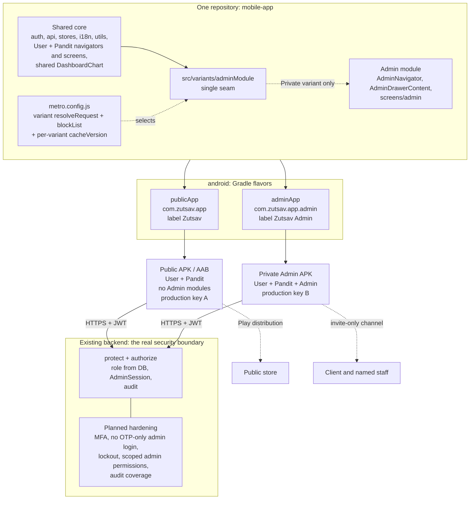

# Public / Private Android build architecture and Admin security audit (Day 34)

| | |
|---|---|
| **Status** | READ-ONLY AUDIT. Nothing was implemented, built, signed, staged or committed. |
| **Date** | 2026-11-06 |
| **Branch / HEAD** | `main` at `af7dcdaff8de595ca8822e1069a071c16b529d28` ("final: production-application") |
| **Working tree at start** | clean (`git status --short` printed nothing) |
| **Subject** | `mobile-app/` (Expo SDK 51.0.39, React Native 0.74.5, bare `android/` committed) and the backend authorization paths it depends on (`backend/src`) |
| **Question** | Can one shared mobile codebase safely produce a **Public** APK (User + Pandit) and a **Private** APK (User + Pandit + Admin)? |

Confidence labels used throughout:

- **[CONFIRMED]** confirmed by reading source code or configuration in this repository.
- **[INFERRED]** follows from the confirmed architecture but was not directly observed.
- **[VERIFY]** needs a build, bundle inspection, or an actual Android device to confirm. Nothing was built in this audit.
- **[DECISION]** needs an owner / client decision.

No secret, password, keystore path or signing material appears in this document. Environment variables are referred to by name only.

---

## A. Executive summary

**Feasibility: yes, with one mandatory refactor and one important caveat.**

1. **One codebase, two APKs is compatible with this repository.** [CONFIRMED] `mobile-app/android/` is committed and is what Gradle/EAS actually build (`docs/ANDROID_RELEASE_AND_MAPS.md:5-14`), so Android product flavors are the natural mechanism. There is no `app.config.js`, no `expo-updates`, no Expo Router, and no firebase/google-services file, so none of those get in the way.
2. **Today the Admin code is in every APK.** [CONFIRMED] `RootNavigator.jsx:11` has a top-level `import AdminNavigator`, which statically pulls in 20 Admin screens, `AdminDrawerContent` and `@react-navigation/drawer`. The `if (user.role === 'admin' …)` at `RootNavigator.jsx:71` only decides what is *rendered*; it does not remove anything from the bundle.
3. **A runtime check, a hidden tab, or `EXPO_PUBLIC_APP_VARIANT` is not a security boundary** and does not exclude code. What genuinely excludes Admin modules is making them *unreachable in the Metro module graph* for the Public build, and then making any accidental reference *fail the bundle*.
4. **Recommended exclusion design** (section D): one seam module (`src/variants/adminModule`), resolved to a stub by a `resolveRequest` rule in `metro.config.js` for the Public variant, plus a Metro `blockList` for the Admin folders in that variant so a stray import breaks the build instead of silently shipping Admin code. Verified afterwards by inspecting the bundle's source map and the final APK. This needs no new bundler and no repository split.
5. **One prerequisite blocks a clean exclusion:** `PanditEarningsScreen.jsx:12` imports `components/admin/DashboardChart`. That chart is a generic component that happens to live in an `admin` folder. It must be moved to a shared location first, or Pandit would break (or Admin code would stay in the Public bundle).
6. **Recommended identities** (section E): Public keeps `com.zutsav.app`; Private becomes `com.zutsav.app.admin` through a flavor `applicationIdSuffix` (the Kotlin `namespace` can stay `com.zutsav.app`, so no source moves). Separate label, icon, URL scheme, version counter and signing key.
7. **The backend is the real security boundary, and for the *role check itself* it is sound.** [CONFIRMED] Roles are read from the database on every request (`middleware/auth.js:13-14,44`), never from the token or the client; all admin routers are guarded server-side (`admin.routes.js:18`, `adminManagement.routes.js:9`, and per-route guards in the mixed routers); admin sessions are revocable and audited. **But the Admin account itself is weakly protected:** no MFA or step-up, admin accounts can sign in with an OTP alone, no lockout, no least-privilege split inside `admin`, and uneven audit coverage (section F). Splitting the APK reduces exposed *mobile* functionality; it does **not** reduce these risks, and the website already ships the Admin UI to every visitor (`frontend/src/App.jsx:29,244-247`).
8. **Two mobile behaviours must be fixed as part of the split** because they become security-relevant: (a) the app persists the session *before* any role decision (`authStore.js:43-47`), and (b) if the Admin branch is removed, an admin session falls through to the **User** navigator (`RootNavigator.jsx:104-108`) with an admin token.

**Verdict:** proceed with the one-codebase / two-flavor design, but treat it as an attack-surface and distribution measure, and schedule the backend Admin-account hardening in parallel because that is where a compromised Admin account is actually stopped.

---

## B. Current architecture

### B.1 Working-tree and baseline state [CONFIRMED]

- Branch `main`, HEAD `af7dcda`, clean tree. Nothing was reset, stashed, staged or modified. The only new file is this document.
- **Day 33 Pandit KYC navigation fix is in HEAD and untouched:** `initial: false` is present at `PanditDashboardScreen.jsx:144,183` and `PanditNotificationsScreen.jsx:25-27`; its test is `src/navigation/__tests__/PanditKYCBackNavigation.test.jsx`.
- Historical baseline from `docs/MOBILE_TESTING.md:901`: 102 suites / 2,096 tests passed on Day 33. **Not re-run here** (read-only audit), so treat it as historical evidence only.
- Backend has 38 test files under `backend/tests/`. I read their names only; I did not find a systematic "every admin route rejects user/pandit tokens" matrix test (name-level observation, [INFERRED]).

### B.2 Roles and app structure

| Item | Evidence |
|---|---|
| Roles | `User.js:16`: `enum ['user','pandit','admin','system_admin']`. `utils/roleUtils.js` groups `admin` + `system_admin` as "admin tier". |
| Entry | `package.json:4` `main: index.js` → `index.js:1-5` `registerRootComponent(App)` → `App.jsx` → `NavigationContainer` → `RootNavigator`. Single entry, no variants. |
| Role routing | `RootNavigator.jsx:61-108`: not ready → spinner; no user → `Auth`; `admin`/`system_admin` → `Admin`; `pandit` → `PanditGate` until `status==='approved'`, then `Pandit`; **everything else → `User`**. The role comes from `useAuthStore().user.role`. |
| Session | `authStore.js`: token + user JSON in `expo-secure-store` (`zutsav_token`, `zutsav_user`), `hydrate()` at lines 25-37. Axios attaches `Bearer` per request (`api/axios.js:14-20`). |
| Bundler | `metro.config.js:1-3` is the stock `getDefaultConfig`. `babel.config.js:1-9` is `babel-preset-expo` + reanimated plugin. No aliases, resolvers, block lists or variant logic. |
| Native | `android/app/build.gradle`: single `applicationId 'com.zutsav.app'` (line 123), `namespace` (121), `versionCode 1` / `versionName "1.0.0"` (126-127). **No product flavors.** Build types: `debug`, `release`, `localTest` (lines 147-170). |
| Expo config | `app.json` is static JSON (no `app.config.js`): name `Zutsav` (3), scheme `zutsav` (8), package `com.zutsav.app` (34), versionCode 1 (35). Because `android/` is committed, `app.json` does **not** drive the native build (`ANDROID_RELEASE_AND_MAPS.md:7-14`). |
| EAS | `eas.json:5-37` profiles `development` / `preview` / `production` differ only in `EXPO_PUBLIC_*` URLs and build type. No `channel`, no `runtimeVersion`, no `projectId`. |
| OTA updates | None. `AndroidManifest.xml:21` `expo.modules.updates.ENABLED=false`; `expo-updates` is not in `package.json`. |
| Push | `utils/fcm.js:14-57` requests permission and obtains an Expo push token, but `App.jsx:107` ignores the return value and nothing sends the token to the backend; `addResponseListener` (fcm.js:62-63) is exported but never used. In-app notifications arrive over Socket.IO (`utils/socket.js`). No `google-services.json` is tracked. |

### B.3 Build workflows that exist today [CONFIRMED unless noted]

| Workflow | How | Signing | Notes |
|---|---|---|---|
| Debug | `expo run:android` / `assembleDebug` | `android/app/debug.keystore` (the public RN debug key, tracked) | Cleartext allowed by the debug manifest overlay. |
| Release (production-connected) | `assembleRelease` / `bundleRelease`, or `eas build --profile production` (`package.json:11`) | Gradle reads `ZUTSAV_RELEASE_STORE_FILE`, `_STORE_PASSWORD`, `_KEY_ALIAS`, `_KEY_PASSWORD` from env or Gradle properties (`build.gradle:28-35,136-145`). The guard at `build.gradle:234-244` refuses to package a release without them and never falls back to the debug key. | `eas.json` production uses `https://api.zutsav.com` hosts. The *production-connected APK workflow itself* is not separately documented in the docs I read. [VERIFY with owner which key signed it.] |
| `localTest` | `assembleLocalTest` (`build.gradle:164-169`) | Same four `ZUTSAV_RELEASE_*` values; guard at 250-270 | Release + a network-security-config for one private LAN host; version name suffix `-localtest`. Signed with the throwaway internal-testing key kept outside the repo (`ANDROID_RELEASE_AND_MAPS.md:119-121`). |

Static guards for the above live in `src/config/__tests__/androidRelease.test.js` (names read, not run).

---

## C. Role / screen inventory

### C.1 Navigators

| Navigator / module | Role | Owner | Shared with other roles? | Public build | Private build |
|---|---|---|---|---|---|
| `RootNavigator` (`src/navigation/RootNavigator.jsx`) | all | App.jsx | yes (role switch, sockets, cart, pandit gate) | yes (modified to drop the Admin import) | yes |
| `AuthNavigator` (9 screens) | none/guest | RootNavigator | yes | yes | yes |
| `UserNavigator` (4 tabs: Home, Bookings, Shop, Profile; ~34 screens) | user | RootNavigator | screens reused by Pandit and Admin (below) | yes | yes |
| `PanditGateNavigator` (Status, KYC) | pandit not yet approved | RootNavigator | `PanditKYCScreen` is also in PanditNavigator | yes | yes |
| `PanditNavigator` (4 tabs; 22 Pandit screens) | pandit | RootNavigator | reuses User screens (Blogs, Festivals, Panchang, Invoice, Legal*, ChangePassword, DeleteAccount) | yes | yes |
| `AdminNavigator` (Drawer → bottom tabs + 8 drawer entries; nested stacks) | admin, system_admin | RootNavigator (`RootNavigator.jsx:11,71-77`) | **no** | **excluded** | yes |
| `AdminDrawerContent` | admin | AdminNavigator | no | excluded | yes |
| No Expo Router | n/a | n/a | n/a | n/a | n/a |

### C.2 Admin-only modules [CONFIRMED]

- Screens (`src/screens/admin/`, 20 registered in `AdminNavigator.jsx:10-29`): Dashboard, ActionCenter, Bookings, BookingDetail, Pandits, PanditDetail, Users, UserDetail, Orders, OrderDetail, Profile, Refunds, RefundDetail, Blogs, BlogDetail, Communication, ReferralAnalytics, Analytics, GlobalSearch, SystemHealth.
- `ComingSoonScreen.jsx` exists in the same folder but is not imported anywhere (dead file).
- `navigation/AdminNavigator.jsx`, `navigation/AdminDrawerContent.jsx`.
- npm: `@react-navigation/drawer` is imported only by those two files (0 non-admin importers). It is not Admin-native code, so excluding its imports simply removes it from the JS graph; it can stay in `package.json`.
- Assets: none. There are no Admin-specific images; Admin screens use `@expo/vector-icons` only. `assets/` holds one icon/splash set.

### C.3 Shared modules that Admin depends on (do **not** classify as Admin-only)

| Module | Non-Admin importers | Verdict |
|---|---|---|
| `api/axios`, `store/themeStore`, `store/authStore`, `utils/helpers` (33) | many | shared core |
| `components/ScreenHeader` (50), `LoadingSpinner` (34), `EmptyState` (15), `StatusBadge` (11) | many | shared |
| `utils/quickActions` | 3 Pandit screens (`PanditBookingDetailScreen`, `PanditReferralDetailScreen`, `PanditStatusScreen`) | shared (its header comment says "admin" but it is not Admin-only) |
| `screens/user/{NotificationsScreen, InvoiceScreen, PersonalInfoScreen, ChangePasswordScreen}` | registered inside `AdminNavigator.jsx:30-33` and in User/Pandit navigators | shared, must stay |
| **`components/admin/DashboardChart.jsx`** | **`PanditEarningsScreen.jsx:12` (used at 162, 167)** | **shared in practice, misfiled under `admin/`. Move to `components/shared/` before any folder-level exclusion.** |

This is the only cross-role import that crosses the Admin boundary: a repo-wide search found no other non-Admin file importing `screens/admin`, `components/admin` or `navigation/Admin*`. [CONFIRMED]

### C.4 Deep links, notifications and cross-role navigation

- **Deep links:** `App.jsx:27-53` `linking` maps only `Auth → Register` (`register`). Prefixes include `https://www.zutsav.com` / `https://zutsav.com`, but the manifest has no `https` data and no `autoVerify` (`AndroidManifest.xml:29-35`; also `docs/PAYMENT_RETURN_DEEP_LINKS_AUDIT.md` P-08), so only `zutsav://` and `com.zutsav.app://` reach the app. No Admin route is deep-linkable. [CONFIRMED]
- **Notification routing:** tap handling lives in `NotificationsScreen.jsx:61-83` (booking/order lookups by number) and Pandit-specific `customHandlers` in `PanditNotificationsScreen.jsx`. The Admin navigator reuses `NotificationsScreen` with no custom handlers. No push-tap navigation exists (response listener unused). No role-specific route is reachable from a notification payload into Admin. [CONFIRMED]
- **Cross-role route names:** User, Pandit and Admin stacks each register an `Invoice` route; `Notifications`/`ChangePassword` are re-registered inside the Pandit profile stack so shared screens resolve (`PanditNavigator.jsx:96-101`). Removing Admin does not touch any of these.

### C.5 Can Admin be isolated without breaking other roles? [CONFIRMED / INFERRED]

Yes. The Admin graph has exactly one inbound edge (`RootNavigator.jsx:11`) plus the `DashboardChart` edge from Pandit. After moving `DashboardChart`, the Admin module is a leaf: nothing in User, Pandit, Auth, notifications, session handling or invoice navigation imports it. Two test files reference Admin modules and need variant awareness: `RootNavigator.session.test.jsx:34` (mocks `../AdminNavigator`) and `InvoiceScreen.test.jsx:241-248` (asserts the invoice entry points, including two Admin screens, by reading source files).

---

## D. Public bundle exclusion strategy

### D.1 What Metro actually does here

- Metro bundles every module reachable from the entry through `import`/`require` calls it can see **statically**. A top-level `import AdminNavigator from './AdminNavigator'` is always collected, whatever the runtime `if` does. [CONFIRMED by construction; the import is at `RootNavigator.jsx:11`]
- In **non-dev** builds the installed Metro transform worker (`metro-transform-worker@0.80.12`, `src/index.js`) runs `inlinePlugin` (line 129), then `constantFoldingPlugin` (lines 143-157, only when `!options.dev`), and only **then** `collectDependencies` (line 184). So a `require()` inside a branch that folds to a compile-time constant `false` is dropped from the dependency graph. [CONFIRMED from the installed source]
- `babel-preset-expo@11.0.15` inlines `process.env.EXPO_PUBLIC_*` at build time (`inline-env-vars.js`), but only for production-style transforms (`common.js: getInlineEnvVarsEnabled`; dev env vars are injected differently). [CONFIRMED]
- Whether the folding pass actually removes a specific `"public" === "admin"` comparison and its `require` for *this* app, with this preset and Hermes, has **not been observed** (no build was run). [VERIFY]
- I found no variant or `EXPO_PUBLIC_*` entry in the cache key of `@expo/metro-config`'s `ExpoMetroConfig.js` (grep for `cacheVersion|EXPO_PUBLIC` returned nothing; Metro's default `cacheVersion` is the constant `"1.0"`). Two variants built on one machine could therefore reuse each other's transform cache. [INFERRED → VERIFY] Mitigation: set a variant-specific `cacheVersion` in `metro.config.js` and/or always pass `--reset-cache` for release bundles.

### D.2 Approaches evaluated

| # | Approach | Is Admin code *absent* from the Public bundle? | Notes |
|---|---|---|---|
| 1 | Keep the static import; gate by `user.role` or a variant env flag at runtime | **No. Present but unreachable.** | Today's state. A modified APK or a rooted device can still reach it. Rejected as a boundary. |
| 2 | `const AdminNavigator = IS_ADMIN_BUILD ? require('./AdminNavigator').default : null` with `IS_ADMIN_BUILD` from `process.env.EXPO_PUBLIC_*` | **Yes, if** constant folding removes the branch in the release transform. | Source shows the pass ordering is right; the effect is [VERIFY]. Fragile: depends on the env var being set and on the folder's folding rules; if it is unset or the expression is not foldable, it fails **open** (Admin ships). |
| 3 | **Variant seam + Metro `resolveRequest` (or `sourceExts` suffix) redirecting `src/variants/adminModule` to a stub for the Public variant** | **Yes.** The real module is never resolved, so its whole subtree is never collected. | Deterministic file selection; no reliance on folding. Needs one small, greppable rule in `metro.config.js`. Default must be Public (Admin only when the variant is explicitly `admin`), so a missing env value fails **closed**. |
| 4 | Metro `resolver.blockList` for `src/screens/admin/`, `src/navigation/Admin*`, `src/components/admin/` in the Public variant | Enforcement, not selection. Any leftover import makes the bundle **fail**. | Use together with #3. Requires `DashboardChart` to be moved first. |
| 5 | Separate variant entry points (`index.public.js` / `index.admin.js`) each importing its own root | Yes, but duplicates the root wiring (`App.jsx`, `RootNavigator` session/gate logic). | `build.gradle:42` resolves the entry through `expo/scripts/resolveAppEntry` (package.json `main`); per-flavor entries would need an extra Gradle hook. More moving parts than #3 for the same result. |
| 6 | Split into packages / second repo / monorepo workspaces | Yes | Major rewrite with no evidence it is needed. Rejected (also explicitly out of bounds for this audit). |
| 7 | Obfuscation / R8 / Hermes bytecode | **No.** | Hermes bytecode and minification slow reading; they do not make client code unrecoverable. R8/ProGuard is currently off (`build.gradle:100,156`) and would need its own testing. Not a boundary. |

### D.3 Recommended approach (most maintainable for this repo): #3 + #4, verified by artifact inspection

1. **Seam:** `src/variants/adminModule.js` exports `{ AdminNavigator, ADMIN_AVAILABLE: true }` (real, Private). A sibling `adminModule.public.js` exports `{ AdminNavigator: null, ADMIN_AVAILABLE: false }`. `RootNavigator.jsx` imports only the seam; its admin branch becomes "admin-tier role and `ADMIN_AVAILABLE` → Admin, otherwise → unsupported-role handling" (see G.2).
2. **Selection:** `metro.config.js` reads one build-time variable (e.g. `ZUTSAV_APP_VARIANT`, read by Metro in Node, **not** an `EXPO_PUBLIC_*` constant in app code) and, for `public` (the default), resolves the seam to the stub and adds the `blockList` entries. Setting `cacheVersion` per variant belongs here too. The existing `getDefaultConfig` call stays.
3. **Fail-closed checks:** the Gradle build already refuses misconfigured releases (`build.gradle:234-270`); extend that pattern so a flavor/variant mismatch (for example the Admin flavor built with the variant unset, or the Public flavor built with `admin`) aborts the build.
4. **Prove it, don't assume it** (all are [VERIFY] until run):
   - Export the JS bundle with a source map for each variant and assert the `sources` list contains **no** path under `src/screens/admin/`, `AdminNavigator`, `AdminDrawerContent`, `components/admin/` or `@react-navigation/drawer` for Public, and **does** contain them for Private.
   - Scan the final Public APK's `assets/index.android.bundle` (Hermes bytecode, so search the string table) for Admin endpoint literals that the mobile Admin screens actually call, such as `/admin/bookings`, `/admin/system-health`, `/admin/broadcast`, `/admin/activity-feed`. They should be absent in Public and present in Private. (No non-test source outside the Admin folders contains `'/admin/'` request paths today, so the scan has no false-positive source; [CONFIRMED by repository-wide grep].)
   - A Jest/Node test that loads `metro.config.js` for each variant and asserts the resolver output.
5. **Honest limits:** exclusion removes Admin *implementation and endpoint literals* from the Public APK. It does not hide the Admin API (the website bundle already contains the Admin UI, `frontend/src/App.jsx:29`), and it does not make the Private APK un-reverse-engineerable.

### D.4 Mandatory pre-work for any exclusion

- Move `components/admin/DashboardChart.jsx` to `components/shared/` (3 importers to update: `PanditEarningsScreen`, `AdminDashboardScreen`, `AdminAnalyticsScreen`). Behaviour-neutral, testable by the existing Pandit earnings tests.
- Delete or leave `ComingSoonScreen.jsx` (unreferenced); it must at least be inside the blocked folder.
- Update the two tests that reference Admin modules (C.5).

---

## E. Expo / Android build strategy

### E.1 Mechanism: Gradle product flavors, with EAS profiles only as an optional wrapper

Because `android/` is committed and `app.json` is static, **changing `app.json` or EAS env alone cannot change the application ID, label, icon or manifest** (`ANDROID_RELEASE_AND_MAPS.md:7-14`). The supported mechanism in this repo is a flavor dimension, for example `distribution { publicApp, adminApp }`, crossed with the existing `debug` / `release` / `localTest` build types. If EAS Build is used, each flavor gets its own profile pointing at the flavor's Gradle task (`android.gradleCommand`, `eas.json`) plus its own `env`. [INFERRED from how the project is wired; EAS itself was never exercised: there is no `projectId`.]

**Impact the owner should know about:** adding flavors renames every Gradle task (`assembleRelease` → `assemblePublicAppRelease` / `assembleAdminAppRelease`, `assembleLocalTest` → per-flavor). The signing and local-test **guards** in `build.gradle:234-270` match the *exact old task names*; if they are not updated in the same change they would silently stop firing and a release could be packaged unsigned or debug-signed. `androidRelease.test.js` and the docs describe the old names too. This is the highest-risk mechanical step of the migration.

### E.2 Application identity

| Property | Public | Private Admin | Evidence / note |
|---|---|---|---|
| `applicationId` | `com.zutsav.app` (unchanged) | `com.zutsav.app.admin` (`applicationIdSuffix ".admin"`) | Current ID is `build.gradle:123`, `app.json:34`, iOS bundle id `app.json:20`. A Play package name is permanent, so the store-facing app should keep the existing ID. [DECISION] |
| `namespace` / Kotlin package | `com.zutsav.app` | same | `build.gradle:121`; `MainActivity.kt` / `MainApplication.kt` stay in `com.zutsav.app`. Namespace is independent of `applicationId`, so no source move. |
| Side-by-side install | n/a | works because IDs differ | [VERIFY] ContentProvider authorities from libraries (`expo-sharing`, `expo-print`, `expo-clipboard`, image picker) must derive from `${applicationId}`; check the merged manifest of both flavors for authority collisions. |
| App label | `Zutsav` (`res/values/strings.xml:2`) | `Zutsav Admin` via `src/adminApp/res/values/strings.xml` | |
| Icon / splash | current `ic_launcher*` mipmaps | distinct mipmaps (badge/colour) via flavor resources | `assets/icon.png` only matters to a future `expo prebuild`. Distinct icon is a safety aid so staff do not confuse the two. |
| Version | `versionCode`/`versionName` hard-coded (`build.gradle:126-127`, mirrored `app.json:5,35`) | independent counter per application ID | Play (or any updater) tracks versionCode per package. Recommend a single source (Gradle property) bumped per flavor. |
| URL schemes | `zutsav`, `com.zutsav.app` (`AndroidManifest.xml:33-34`) | **not** `zutsav`; use `zutsav-admin` and/or `com.zutsav.app.admin` | If both installed apps claim `zutsav://`, Android shows a chooser for `zutsav://register?ref=…` referral links. The Admin app needs no referral/registration link. Also make `linking.prefixes` (`App.jsx:28`) variant-aware. |
| Hard-coded ID strings | `mapConfig.js:37` OSM user-agent contains `com.zutsav.app` | variant-aware or generic | cosmetic, but listed so it is not missed. |
| Permissions | unchanged | unchanged (same libraries are bundled) | The Admin screens add no native permission. |
| Notification identity | no FCM/Firebase configured, and the push token is never registered with the backend (B.2) | same | If FCM is added later each `applicationId` needs its own Firebase app / `google-services` entry. No work needed now. |

### E.3 Storage and session isolation

Android gives each `applicationId` its own sandbox, so `SecureStore` (`zutsav_token`, `zutsav_user`), `AsyncStorage` (`zutsav_cart`, caches) and Socket.IO state are not shared between the two installed apps, even though key names are identical. [INFERRED from the Android model; VERIFY on a device with both installed and different accounts.] `allowBackup=false` plus the exclusion XML (`AndroidManifest.xml:17`) already prevent cloud/transfer restore of sessions. The two apps can hold two different logins at once; that is expected.

**Migration hazard** [CONFIRMED by code]: if a device already has an old `com.zutsav.app` build with an **admin** session in SecureStore (internal test builds contain Admin), and the new Public build is installed over it, `hydrate()` restores that admin user and token. With the Admin branch gone, `RootNavigator.jsx:104-108` would mount the **User** navigator with an admin token. The Public build needs an explicit "unsupported role → clear session, show message" branch (G.2).

### E.4 OTA updates

None today (no `expo-updates`, updates disabled in the manifest, no channel/runtimeVersion in `eas.json`). Therefore no OTA cross-delivery can happen now. [CONFIRMED] If OTA is ever introduced, each flavor needs its own update channel and a `runtimeVersion` that differs per variant, plus a CI check that an Admin bundle can never be published to the Public channel. [DECISION later]

### E.5 JS variant selection and build commands

- Gradle's JS bundling uses `bundleCommand = "export:embed"` through the Expo CLI (`build.gradle:47-50`), a child process that inherits the Gradle process environment. The variant must therefore be set as an environment variable (or Gradle-driven env) for that child; a small wrapper script per flavor that exports the variant and calls the matching Gradle task is the simplest, auditable form.
- The Gradle `whenReady` guard should assert `flavor ↔ variant` equality (E.1/D.3) and refuse mismatches.
- Do **not** put any Admin credential, key or password in either APK or in `EXPO_PUBLIC_*` (those are bundled and readable; `.env.example:4-8` already says so).

### E.6 Environment / backend targeting

Both flavors use the same backend. `eas.json:26-36` already carries the production URLs; the existing `EXPO_PUBLIC_API_URL`, `EXPO_PUBLIC_BASE_URL`, `EXPO_PUBLIC_WEB_URL` mechanism works unchanged for both. `.env` (gitignored, `mobile-app/.gitignore`) holds only those three names.

---

## F. Backend authorization audit

All of this is read-only; no backend file was changed and no request was sent.

### F.1 How roles and sessions work [CONFIRMED]

| Topic | Finding |
|---|---|
| Role representation | `User.role` enum `user | pandit | admin | system_admin` (`models/User.js:16`). |
| Token contents | Regular: `{ id, v }` (`auth.controller.js:27-32`). Admin-tier: `{ id, sid }` (`:36-42`, default lifetime `ADMIN_JWT_EXPIRES_IN || '24h'`). **The role is not in the token.** |
| Where the role is decided | `protect` verifies the JWT, loads the user from MongoDB, rejects inactive/deleted users (`middleware/auth.js:13-18`), checks `tokenVersion` when `v` is present (`:26-28`), checks the `AdminSession` row when `sid` is present (`:34-42`), then sets `req.user` from the **database record** (`:44`). `authorize(...roles)` reads `req.user.role` (`:78-87`); `system_admin` passes every check, `admin` does not pass `system_admin`-only routes. A client-edited role (including the cached `zutsav_user` JSON) cannot change server decisions. |
| Centralized or repeated? | Mostly centralized at router level (table F.2), with per-route `protect, authorize('admin')` in mixed routers. |
| Dependence on frontend guards | None found. The mobile `RootNavigator` branch and the web `ProtectedRoute` are UX only. |
| Rejection behaviour | 401 `Not authenticated` / `Invalid or expired token` / `Session expired or revoked`; 403 `Access denied`. |
| Rate limiting | `/api/auth` 30 req / 15 min per IP, `/api` 500 / 15 min (`app.js:76-103`); OTP resend and cooldown limits in the OTP controllers. |
| Logout / revocation | Admin-tier: `logout` marks the `AdminSession` inactive and audits (`auth.controller.js:481-500`). `system_admin` can revoke a session, force-logout an admin, suspend, reset password, soft-delete (`adminManagement.routes.js:22-25`, controller revokes sessions with a reason). Regular user/pandit tokens have **no per-session record**: they stay valid until expiry (default `30d` remembered) unless `tokenVersion` changes (password reset) or the account becomes inactive. |
| Admin audit trail | `LoginHistory` rows and `audit()` entries for admin login / failed login / logout (`auth.controller.js:396-405,457-470,490`); `AdminAuditLog` and an `audit` helper used across several admin controllers. |
| MFA / re-authentication | **None.** A search for `mfa|totp|two-factor|2fa|authenticator|re-auth|step-up` in `backend/src` matches only the Pandit KYC document OTP (`pandit.routes.js:43-44`, `pandit.controller.js:184,220`). |

### F.2 Server-side enforcement by endpoint group [CONFIRMED by reading the route files]

| Group (mount in `app.js:154-185`) | Guard | Notes |
|---|---|---|
| `/api/admin/*` (127 handlers in `admin.routes.js` + nested config-center, wallet, coupons, campaigns, user-referrals, booking-rewards, documents, footer-links) | `router.use(protect, authorize('admin'))` (`admin.routes.js:18`) applied before every nested router | Admin and system_admin pass. No finer permission inside `admin`. |
| `/api/admin-management/*` (admins CRUD, sessions, force-logout, audit logs) | `protect, authorize('system_admin')` (`adminManagement.routes.js:9`) | Plain `admin` cannot reach it. Good. |
| `/api/comm/*` | `protect, authorize('admin')` (`comm.routes.js:5`) | |
| Mixed routers: `pooja`, `festival`, `temple`, `marketplace`, `livestream`, `heroBanner`, `referral` | public reads; every create/update/delete/admin-list route has explicit `protect, authorize('admin')` (I read every route line) | Per-route, easy to forget on a new route, but all present today. |
| `/api/pandits/*` | `protect, authorize('pandit','admin')` (`pandit.routes.js:14`) after a few earlier public/`protect`-only routes | Admin tokens can use Pandit self-service routes. |
| User-facing routers (`bookings`, `users`, `wallet`, `notifications`, `invoices`, `coupons`, `location`, `masters`, `checkout`) | `protect` | Object-level ownership is in controllers; **not reviewed in this audit**. |
| Blog update/delete | `protect` + controller check "author or admin" (`blog.controller.js:273,334,368`) | Appropriate. |
| Socket.IO (`server.js:49-69`) | `jwt.verify` only, then joins `user_<id>` | No admin rooms. Does **not** consult `AdminSession`, `isActive` or `tokenVersion`. |

**Conclusion on the direct question:** no endpoint in the groups above was found to be reachable by a `user` or `pandit` token on an Admin function, and none depends on the frontend. Sufficient *for role separation*, [CONFIRMED by source reading]. Not exercised by tests or live requests, so [VERIFY] with a role-matrix test (section K).

### F.3 Findings that matter for a compromised Admin account

| ID | Finding | Evidence | Confidence | Severity (my judgement) |
|---|---|---|---|---|
| F-1 | **Admin-tier accounts can sign in with an OTP alone** (WhatsApp/email), with no password, and receive a full admin session. Possession of the phone/email channel (SIM swap, mailbox compromise) is enough. | `otpLogin.controller.js:205-224` | CONFIRMED | High |
| F-2 | **No MFA / step-up** for admin login or for high-value actions (refund processing, payouts, data cleanup, settings, broadcast, admin creation). | F.1 (search negative) | CONFIRMED | High |
| F-3 | **No account lockout.** `failedLoginCount` is incremented and reset but never read for a decision; protection is only the per-IP 30/15 min limiter. | grep: only `auth.controller.js:400,458`, `otpLogin.controller.js:217`, `User.js:33` | CONFIRMED | Medium |
| F-4 | **No least privilege inside `admin`.** Any plain admin can call payouts (`/payouts/pay-batch`, `pay-single`), refunds, `/data-cleanup/execute`, `/logs/:type/cleanup`, `/settings` (including `test-email`), Config Center `PATCH /:section`, `/broadcast`, and wallet adjustments. Only admin *management* is `system_admin`-only. | `admin.routes.js:18` blanket guard; no per-route `authorize('system_admin')` | CONFIRMED | Medium-High (a single compromised plain admin has the whole operational surface) |
| F-5 | **Audit coverage is uneven.** A heuristic scan of `admin.controller.js` found audit/log markers in refund, assignment, booking status, payout-paid, delete user/pandit, but **none** in `approvePandit`, `updateKYCStatus`, `updateUserStatus`, `updateOrderStatus`, `payBatch`, `sendBroadcast`, blog approve/delete, `updateBlogPermissions`; `systemSettings.controller.js` and `adminWallet.controller.js` show no audit markers. | handler ranges scanned for `audit(`/`AdminAuditLog`/`auditLog`; helper-based logging and ledger rows (e.g. wallet transactions) would not be detected | INFERRED (heuristic, not a per-handler review) | Medium |
| F-6 | **Admin-tier account in `deletion_pending` receives a session-less token.** The login branch for `accountStatus === 'deletion_pending'` signs with `signToken` (no `sid`) before the admin branch (`auth.controller.js:431-444`, same in the OTP controller), and `protect` only checks `AdminSession` when `sid` exists. Whether an admin-tier account can enter that state is not guarded in the deletion handlers I grep-checked. | `auth.controller.js:431-444`, `middleware/auth.js:34` | INFERRED, needs a targeted check | Low-Medium |
| F-7 | **Socket.IO accepts any validly signed JWT**, including a revoked admin session or suspended user, until JWT expiry. Effect is limited to receiving that user's own realtime notifications. | `server.js:49-69` | CONFIRMED | Low |
| F-8 | **Legacy open `POST /api/auth/register` accepts a client-supplied `role`.** Admin tiers are blocked (`isAdminRole(role) ? 'user'`, `auth.controller.js:378`), but `role: 'pandit'` is accepted without OTP/approval flow. Not an Admin escalation; relevant to Pandit trust. | `auth.controller.js:358-391`, `auth.routes.js:13` | CONFIRMED | Low (for this audit) |
| F-9 | Seed admin is created as `system_admin` from `ADMIN_*` env on first run, and `.env.example` ships a weak placeholder password (already recorded as ZUT-SEC-010 in `docs/SECURITY_AUDIT_REPORT.md`). | `utils/seedAdmin.js`, SECURITY_AUDIT_REPORT.md | CONFIRMED | Informational |
| F-10 | Config Center writes are limited to a manifest allowlist and restore skips secrets (`configCenter.controller.js:47,167` comments), which is good; but anything an admin can change there is reachable by every plain admin (F-4). | controller comments | CONFIRMED | n/a |

**Is current backend Admin authorization sufficient?** For *role separation and server-side enforcement of the Admin API*: yes, on the evidence read. For *protecting the Admin accounts and limiting damage from one compromised Admin*: **no** (F-1 to F-5). The client's stated concern (compromised Admin accounts) is only addressed by backend changes; the APK split does not address it.

---

## G. Threat model

### G.1 Table

| Threat | Impact | Existing protection (evidence) | Remaining weakness | Recommended mitigation |
|---|---|---|---|---|
| Admin API accessed through the Public APK | Admin operations if a valid admin credential is used | Server-side role check on every admin route (`admin.routes.js:18`); role read from DB (`auth.js:44`); Public APK will not contain the Admin UI | Any HTTP client can call the same API with an admin token; the website already ships the Admin UI (`frontend/src/App.jsx:29`) so endpoint names are public regardless of the APK | Treat the API as hostile-reachable. Backend hardening (MFA, OTP-login policy, IP/network restriction of `/api/admin` at the proxy, least privilege). |
| Modified / reverse-engineered APK | Attacker learns endpoints, removes client checks, calls the API directly | Server never trusts client role; Hermes bytecode; release not debuggable (`androidRelease.test.js`) | Hermes and (disabled) R8 are speed bumps only; no root/tamper detection; no certificate pinning (not found) | Keep all authorization server-side; do not rely on obfuscation; Public APK exclusion shrinks what is learnable from the mobile app. Optional: Play Integrity checks for sensitive flows. |
| Compromised Admin credentials | Full operational access (payouts, refunds, settings, user data, broadcast) | Revocable `AdminSession`, 24h admin token, login/failed-login audit, `ADMIN_LOGIN` notification, `system_admin` can force logout | No MFA (F-2), OTP-only login (F-1), no lockout (F-3), no least privilege (F-4), uneven audit (F-5) | MFA/TOTP for admin tier; disable or step-up OTP login for admin tier; lockout/backoff; split `admin` into scoped permissions with money-moving routes behind `system_admin` or step-up; complete audit coverage; alert on new device/IP. |
| Token theft / session reuse | Account takeover until expiry | Tokens in `expo-secure-store`; `allowBackup=false`; admin sessions revocable; password reset bumps `tokenVersion` for non-admin tokens | User/pandit tokens live up to 30d with no per-session revocation; admin tokens carry no `v`, so they rely entirely on `AdminSession`; sockets ignore revocation (F-7) | Shorter user token lifetime or refresh-token design (separate decision); revoke sessions on password change for all roles; make Socket.IO check session state for admin tier. |
| Unauthorized role escalation | User/Pandit becomes Admin | Admin tiers blocked in `/auth/register` (`:378`) and `completeRegistration` only emits `pandit`/`user` (`:169,191`); role is DB-sourced; admin creation is `system_admin`-only | Legacy `register` allows self-assigned `pandit` (F-8); no automated test matrix | Add the role-matrix tests (K.3); remove or lock the legacy register route. |
| Private APK leaked | Anyone gains the Admin UI and endpoint list | Login still requires a valid Admin account; server enforces role | The APK is not a secret; if distributed by direct download, a leaked file can be re-shared | Assume leak. Do not embed secrets. Distribute through an invite-only channel, publish the SHA-256 out-of-band, and rely on backend controls above. |
| Wrong OTA update delivered to the wrong variant | Admin code or Public code in the wrong app | No OTA exists (updates disabled; no `expo-updates`) | Becomes relevant only if OTA is added | Keep OTA off, or per-flavor channel + `runtimeVersion` + CI guard (E.4). |
| Deep-link / navigation bypass | Reach a screen the role should not see | Deep links map only `register` (`App.jsx:27-35`); route names are per navigator; server enforces access | Shared `zutsav://` scheme would trigger a chooser between the two apps; custom schemes are unverified (P-14 in the deep-link audit) | Distinct Admin scheme; keep deep links minimal and treat URLs as untrusted hints; no Admin route in `linking`. |
| Shared storage / session confusion | Wrong account in the wrong app, or Admin token surviving into Public | Per-app sandbox; session cleanup on login (`authStore.js:44`, `sessionCleanup.js`) | Upgrade-in-place of an old Admin-capable `com.zutsav.app` build keeps the stored admin session (E.3) | Public build rejects/clears unsupported-role sessions at hydrate and at login; test the upgrade path on a device. |

### G.2 What happens when an Admin logs into the Public APK

**Current behaviour** (single app): [CONFIRMED]
1. `authStore.login()` posts to `/auth/login`; the backend creates an `AdminSession`, writes `LoginHistory`, audits `login`, emits `ADMIN_LOGIN`, and returns an admin token (`auth.controller.js:448-470`).
2. The app **writes the token and user to SecureStore immediately** (`authStore.js:43-47`) and sets state.
3. `RootNavigator.jsx:71-77` renders `Admin`.

**If the Admin branch is simply deleted from the Public build:** the same login would persist the admin session and then fall through to `RootNavigator.jsx:104-108`, i.e. the **User** navigator running on an admin token. That must not ship.

**Recommended policy** [DECISION]:
- Public APK: User and Pandit accepted. An admin-tier account sees a clear message (for example "This account can't be used in this app. Please use the Zutsav Admin app.") and **no session is kept**.
- Private APK: full role flow.

**Minimum enforcement:**
- *Mobile (UX and defence in depth, not security):* decide on `data.user.role` **before** persisting anything in `login`, `loginWithOtp` and `setSession`; if the variant does not support the role, do not store the token, best-effort call `POST /auth/logout` with the returned token to revoke the `AdminSession` that the server just created, and show the message. In `hydrate()`/`RootNavigator`, an unsupported stored role clears the session (covers the upgrade-in-place case in E.3). Replace the "everything else → User" fall-through with an explicit `user` branch plus an unsupported-role branch.
- *Backend (optional, needs separate approval):* an advisory client-identity header (for example `X-Zutsav-Client: public|admin`) lets the server decline to **issue** admin-tier sessions to the Public client, avoiding stray `AdminSession` / `ADMIN_LOGIN` events. It is spoofable, so it is a convenience, not a control.
- *Real protection of admin credentials* is F-1 to F-4: MFA, no OTP-only admin login, lockout, network restriction. A client-side role check never secures Admin endpoints.

---

## H. Signing and distribution

### H.1 Signing identities that exist

| Identity | Where / evidence | Used for | Notes |
|---|---|---|---|
| Debug keystore | `android/app/debug.keystore`, tracked; the standard public React Native debug key (`ANDROID_RELEASE_AND_MAPS.md:33`) | `debug` only; the release guard refuses it (`build.gradle:234-244`) | Not a secret. |
| Throwaway internal-testing keystore | Outside the repo; described in `ANDROID_RELEASE_AND_MAPS.md:119-121` and `MOBILE_TESTING.md` Day 31-32 | `localTest` APKs; CN states it is for testing | An app signed with it cannot be updated by a store build. Which key signed the production-connected APK is not recorded in the files I read. [VERIFY with owner] |
| EAS managed credentials | Referenced in docs only | none proven | No `projectId`; never exercised. |
| Play upload / app-signing key | None evidenced | n/a | Required before any Play release (`ANDROID_RELEASE_AND_MAPS.md:34`). |

No keystore, key, password or signing path is reproduced here; none was created or modified. No keystore, `.jks`, `.p12`, `google-services` or service-account file is tracked other than the public debug key (git ls-files check). A tracked `frontend/.env.production` exists (outside this audit's scope; contents not inspected) and is worth a separate review.

### H.2 Three artifact classes (must stay distinct)

| Artifact | Purpose | Signing | Package | Backend |
|---|---|---|---|---|
| Internal testing APK | developer/QA devices | throwaway testing key | `com.zutsav.app` (today) | LAN (`localTest`) or production URL |
| **Public production APK/AAB** | customers and pandits | owner-controlled production key (Play App Signing + upload key recommended) | `com.zutsav.app` | production |
| **Private Admin APK** | client and named staff | **separate** owner-controlled key | `com.zutsav.app.admin` | production |

### H.3 One key or two? [DECISION; recommendation]

Android allows one keystore to sign apps with different package IDs, so a shared key is technically possible. Recommended: **two separate keys** (and separate EAS credential sets if EAS is used). Reasons: a leaked or lost Admin key then cannot be used to ship a trojan "update" to Public users, revocation/rotation is independent, and the Admin key can live with a smaller group. Whoever holds a key can publish an update that installs over the existing app with the same package ID, so for a directly distributed Admin APK the signing key is effectively the update identity: keep it offline, back it up, and never in the repository (the `ZUTSAV_RELEASE_*` mechanism already keeps it out). Losing a key means installed apps cannot be updated (store-managed signing mitigates this).

### H.4 Distribution options for the Private Admin app

| Option | Pros | Cons / risks |
|---|---|---|
| Direct APK to the client | Simple, no store review, fully owner-controlled | Manual updates; file can be re-shared; users must enable sideloading; integrity depends on out-of-band checksum; update trust rests on the signing key |
| Google Play closed / internal testing track on a separate Admin listing | Invite-only by Google account, automatic updates, Play-managed signing | Needs a Play Console entry for the Admin package; tester limits and eligibility rules [VERIFY current Play policy]; testers need Google accounts |
| Managed Google Play private app / MDM | Organisation-scoped, device policy control | Requires Google Workspace / EMM setup [VERIFY eligibility]; heavier administration |
| Another owner-controlled channel (for example an app-distribution service or MDM-hosted APK) | Invite lists, version history | Third-party dependency; check that it needs no SDK inside the app |

Whatever is chosen: the Admin APK can be reverse-engineered by anyone who gets a copy; the safety net is the backend (F, G), not secrecy of the file. [DECISION] on channel.

### H.5 Public application requirements

Final production signing arrangement, Play listing under `com.zutsav.app`, `versionCode` discipline, a verified privacy-policy/legal path, and the owner-confirmed canonical web host if App Links are ever added (`PAYMENT_RETURN_DEEP_LINKS_AUDIT.md` P-09). Update compatibility: the first Play upload fixes the package name and signing lineage. A build signed with the throwaway testing key cannot be upgraded by a store-signed build, so internal-testing devices will need an uninstall/reinstall.

---

## I. Proposed target architecture

---

## J. Phased implementation plan (not started)

The order differs slightly from the suggested template: a behaviour-neutral refactor must come before any build configuration, and backend hardening is independent of the mobile split, so it can start in parallel and should not wait until the end.

### Phase 0 - Decisions and prerequisites
- Files: none. Build: none. Backend: none.
- Owner decisions: application IDs, signing keys and custody, admin-login policy for the Public app, distribution channel for Admin, backend hardening scope (section L).
- Tests: none. Risk: building on assumed identities that Play later makes permanent.

### Phase 1 - Behaviour-neutral refactor (shared code only)
- Files: move `components/admin/DashboardChart.jsx` to `components/shared/` (update `PanditEarningsScreen`, `AdminDashboardScreen`, `AdminAnalyticsScreen`); add `src/variants/adminModule.js` (+ `adminModule.public.js`); change `RootNavigator.jsx` to import only the seam and add the unsupported-role branch and explicit `user` branch; `authStore.js` role decision before persisting and at `hydrate()`; update `RootNavigator.session.test.jsx` (mock path) and `InvoiceScreen.test.jsx` (entry-point list is variant-aware).
- Config: none yet (Private/full behaviour is the default, so nothing changes for current builds).
- Backend: none.
- Tests: full existing Jest suite must stay green (baseline 102 / 2,096, to be re-measured); new tests for unsupported-role handling and for the seam.
- Risk: touching `RootNavigator` (session, Pandit gate, Day 33 navigation). Keep the Pandit gate logic and Day 33 `initial: false` calls untouched; add a regression test that Pandit approved / pending still route the same.
- Prerequisite: Phase 0 admin-login policy.

### Phase 2 - Metro exclusion and proof
- Files: `metro.config.js` (variant selection, `resolveRequest`, `blockList`, `cacheVersion`); a small verification script; a Jest/Node test of the Metro config.
- Config: one build-time variable read by Metro; default Public (fail closed).
- Backend: none.
- Tests: for each variant, export a bundle with a source map and assert the module list (D.3 step 4). Scan the Hermes bundle strings later in Phase 5.
- Risk: Metro transform-cache reuse across variants (D.1) and a `blockList` pattern that is too broad or too narrow. Mitigation: per-variant `cacheVersion` and `--reset-cache` in release scripts.
- Prerequisite: Phase 1.

### Phase 3 - Android flavors, Public APK, then Private APK
- Files: `android/app/build.gradle` (flavor dimension, `applicationIdSuffix`, per-flavor label/icon/scheme, updated guards using the new task names, flavor ↔ variant assertion); `src/adminApp/` (or equivalent) overlay with `res/values/strings.xml`, icons and a manifest overlay replacing the URL-scheme filter; `App.jsx` `linking.prefixes` variant-aware; version bookkeeping; `app.json` mirror only if the owner wants it; `androidRelease.test.js` and the docs updated for the new task names.
- Config: build wrapper scripts exporting the variant; separate signing values per flavor (`ZUTSAV_RELEASE_*` pattern, or per-flavor names).
- Backend: none required for the split itself.
- Tests: static Gradle/manifest guards updated; merged-manifest inspection for both flavors (IDs, schemes, provider authorities).
- Risk: the guard task-name rename (E.1) silently disabling signing guards; provider authority collisions; wrong icon/label. Public first, because it must exactly match today's app apart from the Admin removal.
- Prerequisite: Phase 2, signing arrangement from Phase 0.

### Phase 4 - Backend authorization hardening (separate owner approval; may run earlier or in parallel)
- Candidate scope, in priority order: (1) MFA/step-up for admin tier and a policy for admin OTP login (F-1, F-2); (2) lockout/backoff using `failedLoginCount` (F-3); (3) scoped admin permissions or `system_admin`/step-up for money-moving and destructive routes (F-4); (4) audit coverage for the unaudited mutating handlers (F-5); (5) review the `deletion_pending` session-less token for admin tier (F-6); (6) Socket.IO session/active check (F-7); (7) lock down legacy `/auth/register` (F-8); (8) optional proxy-level network restriction of `/api/admin`.
- Tests: role-matrix tests (K.3).
- Risk: lock-out of real admins and breakage of the website admin; roll out with a break-glass `system_admin` path.
- Prerequisite: owner approval of scope. Nothing in this audit changed backend code.

### Phase 5 - Verification and release
- Automated regression for both variants, APK artifact inspections (D.3), real-device tests of both apps installed together, distribution and update checks, signed-artifact verification with the production keys (K).
- Risk: untested upgrade-in-place from existing test installs; mitigate with the uninstall policy in H.5 and the unsupported-role handling.

---

## K. Regression and device-testing matrix

### K.1 Automated (Jest / Node, no device)

| Area | Check |
|---|---|
| Public variant | User login and tab navigation; Pandit login, gate and approved navigation (incl. Day 33 KYC back navigation); admin-tier login → message and **no persisted session**; stored admin session at hydrate → cleared; shared screens and services unchanged; `PanditEarningsScreen` still renders its charts from the relocated component |
| Private variant | User and Pandit flows; Admin login routes to `Admin`; all 20 Admin screens still register; shared `Invoice` / `Notifications` / `ChangePassword` routes resolve inside Admin |
| Build isolation | Metro config test per variant (resolver output); source-map module list: Public has **no** `screens/admin`, `AdminNavigator`, `AdminDrawerContent`, `components/admin`, `@react-navigation/drawer`; Private has them; default (no variable set) equals Public |
| Static native guards | Manifest/Gradle tests updated for flavors: IDs, labels, schemes distinct; no cleartext in release; `allowBackup=false` for both; signing guards fire for the **new** task names; no keystore tracked |
| Existing suites | Full `npm run test:ci` (baseline 102 / 2,096) after Phase 1 and again after Phase 3 |

### K.2 Artifact inspection (needs a build; not done here)

Unzip each APK: verify `applicationId`, label, icon, `versionCode`, merged manifest (URL schemes, provider authorities), and that the Hermes bundle string table lacks Admin endpoint literals in Public and has them in Private; verify signing certificate fingerprints differ between the two APKs and neither is the debug or testing key; record SHA-256 per release.

### K.3 Backend security tests (Node, mock requests; no production)

- User token → every `/api/admin/*`, `/api/admin-management/*`, `/api/comm/*` and admin-guarded route in the mixed routers returns 403.
- Pandit token → same; Pandit token on `/api/pandits/*` allowed.
- Plain admin token → `/api/admin-management/*` returns 403; `system_admin` allowed.
- Missing/expired/malformed token → 401; revoked `AdminSession` → 401; suspended user → 401.
- A request body or header claiming `role: admin` never changes the outcome.
- Generate the matrix from the Express router stack so a new route without a guard fails the test.

### K.4 Requires a real Android device [VERIFY]

| Test | Why it cannot be automated here |
|---|---|
| Install both APKs on one device; log into different accounts; confirm separate sessions and storage | Android sandboxing |
| `zutsav://register?ref=…` opens only the Public app (no chooser) | OS intent resolution |
| Upgrade-in-place over an old Admin-capable `com.zutsav.app` install holding an admin session | Real stored state |
| Admin account in the Public app: message shown, no session kept, server session revoked | End-to-end with backend |
| Public build: no Admin screens reachable by any path | Navigation on device |
| Private build: complete Admin walk-through (dashboard, bookings, orders, refunds, pandits, users, blogs, communication, analytics, system health) with an authorized Admin | Real data/permissions |
| Both icons and labels distinguishable; notification channels; file sharing / PDF / image picker still work (provider authorities) | UI and OS |
| Release signing: both APKs install, Play Protect behaviour, update path | Device/OS |

---

## L. Decisions requiring owner / client approval

### Mandatory
1. **Final application IDs** (recommend Public `com.zutsav.app`, Private `com.zutsav.app.admin`).
2. **Signing arrangement**: production key for Public (Play App Signing + upload key), a separate key for Admin, who holds and backs them up, and whether to retire the throwaway testing key. Which key signed the existing production-connected APK.
3. **Admin login in the Public app**: confirm the policy in G.2 (reject with message, no session).
4. **Distribution channel for the Private Admin app** (H.4).
5. **Whether backend Admin hardening is in scope** and in what order (F-1 to F-8). This is what answers the client's compromised-Admin concern; the APK split does not.
6. **Handling of existing internal-test installs** (uninstall vs in-place upgrade).

### Optional enhancements
- Admin URL scheme name and whether the Admin app also keeps the Public scheme (not recommended).
- Distinct Admin icon/theme colour.
- Play Integrity / root detection for the Admin app.
- Certificate pinning.
- Enabling R8/ProGuard (needs its own test cycle).
- OTA updates with per-flavor channels (only if OTA is wanted at all).
- Proxy-level IP allow-listing of `/api/admin`.
- Removing the legacy `/auth/register` route and the unused `ComingSoonScreen`.
- iOS: `app.json:20` holds a bundle id but no `ios/` project is committed; an iOS split is out of scope.

---

## M. Confirmed risks and limitations

### Verified (source-level)
- Admin code ships in every APK today (`RootNavigator.jsx:11`).
- `PanditEarningsScreen` depends on an Admin-folder component (`:12`).
- Session is persisted before any role decision (`authStore.js:43-47`) and a removed Admin branch falls through to the User navigator (`RootNavigator.jsx:104-108`).
- Admin-tier accounts can sign in via OTP alone (F-1); no MFA (F-2); no lockout (F-3); no scoped admin permissions (F-4).
- Server-side role enforcement on all admin routers and mixed-router admin routes read, with the role sourced from the database.
- Socket.IO does not check session state (F-7); legacy register accepts `pandit` (F-8).
- Build guards in `build.gradle:234-270` are keyed to current task names (E.1).
- No OTA, no Firebase, no push registration; the website bundle already contains the Admin UI.

### Theoretical or unproven
- That Metro's constant folding removes a flag-guarded `require` in this project (D.1); the recommended design does not depend on it.
- Transform-cache reuse across variants (D.1).
- Provider-authority collisions with two flavors installed (E.2).
- F-5 (audit gaps) is a heuristic scan, not a per-handler review.
- F-6 (`deletion_pending` admin token) needs a targeted check.
- Object-level authorization in user-facing controllers (bookings, invoices, wallet) was **not** reviewed.

### Unknowns
- Which key signed the production-connected APK; whether EAS credentials exist.
- Actual production values for `ADMIN_JWT_EXPIRES_IN`, `JWT_EXPIRES_IN_REMEMBERED`, proxy/WAF rules in front of the API (not visible in the repository).
- Current Play policy limits for private/closed distribution.
- Whether any live admin account is in `deletion_pending`.

### Limitations of this audit
Read-only: no build, no export, no test run, no network request, no device. Baseline numbers are historical. Everything labelled [VERIFY] must be confirmed during implementation.

---

## N. Scope audit

**No implementation file was modified.** The only file created is `docs/PUBLIC_PRIVATE_APP_ARCHITECTURE_AUDIT.md`. Nothing was staged, committed, pushed, built, signed or deployed; no dependency, lockfile, environment, signing or native file was touched; no API call was made.

### Files and areas inspected (read-only)
- **Mobile config:** `mobile-app/package.json`, `app.json`, `eas.json`, `metro.config.js`, `babel.config.js`, `index.js`, `App.jsx`, `.env.example`, `.gitignore`, `jest.config.js`; `.env` variable **names** only (values not read).
- **Android:** `android/build.gradle`, `android/app/build.gradle`, `android/settings.gradle`, `android/gradle.properties`, `src/main/AndroidManifest.xml`, `src/debug/AndroidManifest.xml`, `src/localTest/AndroidManifest.xml`, `src/localTest/res/xml/network_security_config_localtest.xml` (host redacted in notes), `src/main/res/values/strings.xml`, Kotlin file package lines; tracked-file listing for keystore/credential patterns.
- **Navigation:** `RootNavigator.jsx`, `AuthNavigator.jsx`, `UserNavigator.jsx`, `PanditNavigator.jsx`, `PanditGateNavigator.jsx`, `AdminNavigator.jsx`, `AdminDrawerContent.jsx` (imports), test names.
- **Mobile source:** `store/authStore.js`, `api/axios.js`, `utils/fcm.js`, `utils/socket.js`, `utils/sessionCleanup.js`, `utils/quickActions.js`, `config/env.js`, `screens/user/NotificationsScreen.jsx`, `screens/auth/{Login,LoginOtp,Register}Screen.jsx` (role handling), Pandit Day 33 call sites, import graph for `screens/admin`, `components/admin`, and shared modules; admin endpoint usage summary.
- **Installed tooling (read-only):** `metro-transform-worker@0.80.12`, `metro@0.80.12`, `metro-config`, `@expo/metro-config`, `babel-preset-expo@11.0.15`, `@react-navigation/drawer@6.7.2`.
- **Backend:** `src/app.js`, `server.js` (Socket.IO section), `middleware/auth.js`, `utils/roleUtils.js`, `utils/seedAdmin.js`, `models/{User,AdminSession}.js`, `controllers/{auth,otpLogin,adminManagement}.controller.js`, selected parts of `admin.controller.js`, `configCenter.controller.js`, `blog.controller.js`; every route file listed in `src/routes/` (guards and route lines); `backend/tests/` file names; `backend/.env.example` variable names only.
- **Website:** `frontend/src/App.jsx` admin route and import lines.
- **Docs:** `docs/MOBILE_TESTING.md` (headings, Day 33, follow-ups), `ANDROID_RELEASE_AND_MAPS.md` (full), `MOBILE_LOCALIZATION_AUDIT.md` and `MOBILE_F07_CHECKOUT_PARITY_AUDIT.md` (headings), `MOBILE_APP_USER_PANDIT_PARITY_AUDIT.md`, `MOBILE_FEATURE_GAP_ANALYSIS.md`, `PAYMENT_RETURN_DEEP_LINKS_AUDIT.md`, `SECURITY_AUDIT_REPORT.md` (relevant sections).

### Not inspected
Contents of `mobile-app/.env`, any keystore or signing value, `frontend/.env.production`, controller-level object ownership checks outside the admin and auth paths, and any production system.
